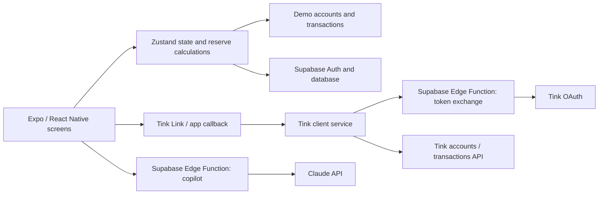

# FINO
### A financial overview for freelancers

A personal **React Native / Expo prototype** that brings accounts, invoices and configurable reserves into one interface. The central idea is **Real Balance**: an overview of the balance remaining after the user's tax and fixed-cost reserve rules.

**Stack:** TypeScript · React Native · Expo Router · Zustand · Supabase · Tink · Claude

**Status:** product prototype with demo data and integration code. Bank connectivity depends on external configuration and sandbox access; this repository does not establish production banking readiness. Reserve amounts are planning estimates, not transfers to separate accounts or a calculation of actual tax liability.

## Explore the implementation

| Area | Entry point |
| --- | --- |
| Dashboard and financial overview | [app/(tabs)/dashboard.tsx](app/%28tabs%29/dashboard.tsx) |
| State, reserve calculations and persistence calls | [store/useFinoStore.ts](store/useFinoStore.ts) |
| Bank-link callback, token exchange and account mapping | [services/tink.ts](services/tink.ts) |
| Authenticated server-side token exchange and refresh-token encryption | [supabase/functions/tink-token-exchange/index.ts](supabase/functions/tink-token-exchange/index.ts) |
| AI copilot endpoint | [supabase/functions/copilot-chat/index.ts](supabase/functions/copilot-chat/index.ts) |
| Invoice PDF generation | [services/generateInvoicePdf.ts](services/generateInvoicePdf.ts) |

## Architecture



The client opens the bank-link flow; the OAuth client secret belongs on the server. The token-exchange function checks the user and encrypts refresh tokens before storage. The copilot receives the financial context supplied by the client; it is a conversational interface, not a payment execution system.

## My contribution

This is my own product-development project: a freelancer-focused workflow combining mobile screens, shared application state, Supabase integration, bank-link handling and server-side AI integration. The links above make the implementation inspectable. External APIs and libraries provide the underlying banking, authentication and model services.

## Product walkthrough

1. Sign in and configure tax/fixed-cost reserve percentages.
2. Open the dashboard to inspect the balance, reserves and recent movements.
3. Browse accounts and invoices; open an invoice and its PDF workflow.
4. Explore the copilot. Configured AI and banking features require their respective backend services.

Without a completed bank connection, the store uses demo accounts and transactions. This is an explicit prototype fallback, not evidence of a live connection.

## Run locally

Use a Node.js version compatible with Expo SDK 54.

```bash
npm ci
npx expo start
```

Use `w` for the web target, or an appropriately configured Android/iOS development environment. Configure your own Supabase environment for authenticated flows; do not use real financial data for portfolio demonstrations.

See [Tink integration](TINK_INTEGRATION.md) and [Tink testing notes](TINK_TESTING.md) for the banking setup. These are implementation/setup notes, not a claim that automated or live integration tests have passed.

## Project structure

```text
app/                  Expo Router screens
components/           Shared interface components
store/                State and financial overview calculations
services/             Tink, PDF and notification integrations
supabase/functions/   Server-side Tink exchange and AI copilot
supabase/migrations/  Versioned database changes present in this repo
data/                 Demo models and data
theme/                Interface tokens
```

## Scope and limitations

The current repository contains prototype calculations and configured-service integrations. It does not demonstrate audited accounting, tax advice, executed payments, regulatory approval or a production service. Authentication and database setup are needed for persisted user flows. Some database objects used by the client are not fully provisioned by the checked-in migrations.
